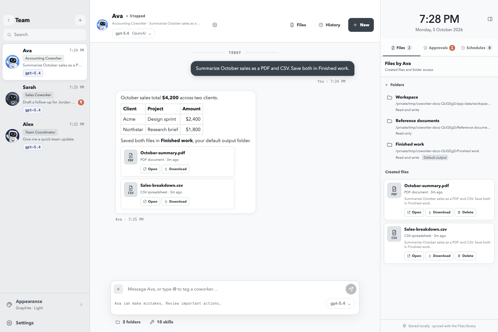
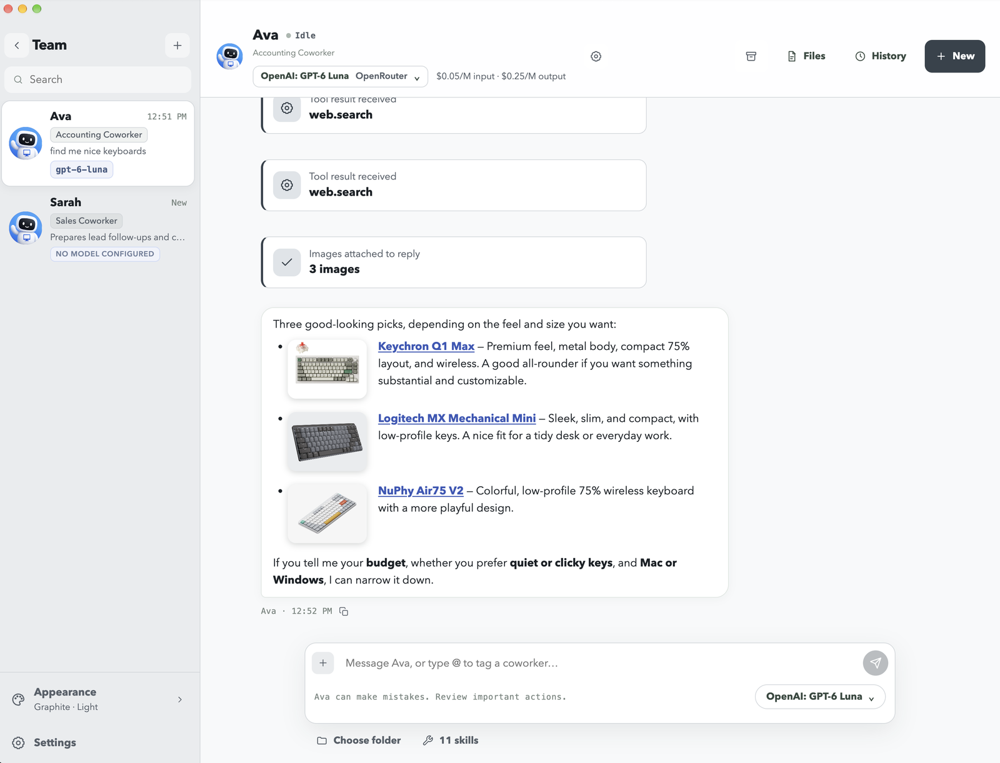

# Coworker

AI agents for your work, running on your own computer.

[](https://github.com/donvito/coworker/releases/latest)
[](LICENSE)




[More screenshots](docs/screenshots.md) · [All features](docs/features.md)



## Why Coworker

- **No subscription** — free to use. Pay a model provider only if you choose one.
- **Runs on your computer** — macOS, Windows, and Linux. Your data stays local.
- **Any model** — [Ollama](https://ollama.com), [LM Studio](https://lmstudio.ai), or your own keys for Anthropic, OpenAI, Google, OpenRouter, and OpenAI-compatible APIs.
- **A team** — coworkers hand work to each other, and a primary coworker keeps everyone coordinated.
- **Skills** — teach coworkers new abilities with Agent Skills.
- **Web search** — free out of the box, with photos beside each result when you're comparing places or products.
- **Files and folders** — give coworkers access to folders, then browse, download, or zip their files.
- **Memory** — coworkers remember the preferences you approve.
- **Scheduler** — recurring and one-time jobs, in plain language.
- **Approvals** — important actions wait for your OK.
- **Telegram and Discord** — chat with coworkers and approve their work from your phone.

## Download

Get the installer for your OS from the [latest release](https://github.com/donvito/coworker/releases/latest). Builds aren't code-signed yet, so your OS warns on first launch. See the [install notes](docs/releasing.md#after-you-download).

## Development

Requires **Node.js 22.12+** and **pnpm**.

```sh
pnpm install
pnpm dev
```

Add a model in **Settings → Model Providers** before chatting. See [Development](docs/development.md) for profiles, scripts, tests, and packaging.

## Terminal and headless mode

Run Coworker without a window while schedules, Telegram, and Discord keep working.

```sh
coworker start
coworker status
```

See the [terminal guide](docs/cli.md).

## Docs

- [Screenshots](docs/screenshots.md)
- [Features](docs/features.md)
- [Memory](docs/memory.md)
- [Terminal and headless mode](docs/cli.md)
- [Development](docs/development.md)
- [Data and security](docs/security.md)
- [Releasing](docs/releasing.md)

## License

[Apache License 2.0](LICENSE)
