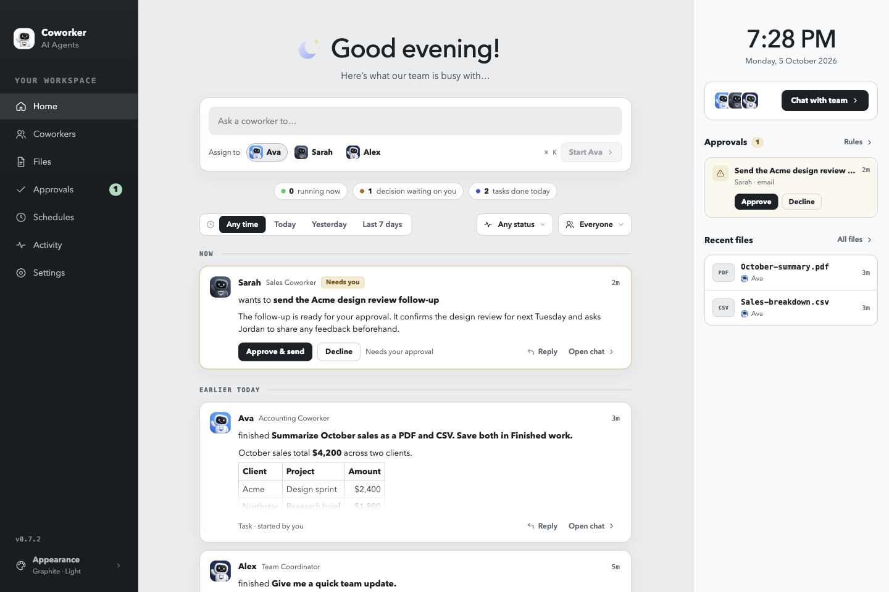
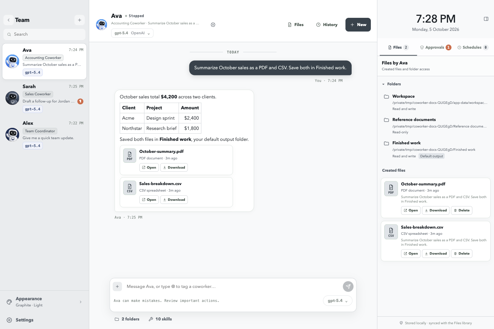
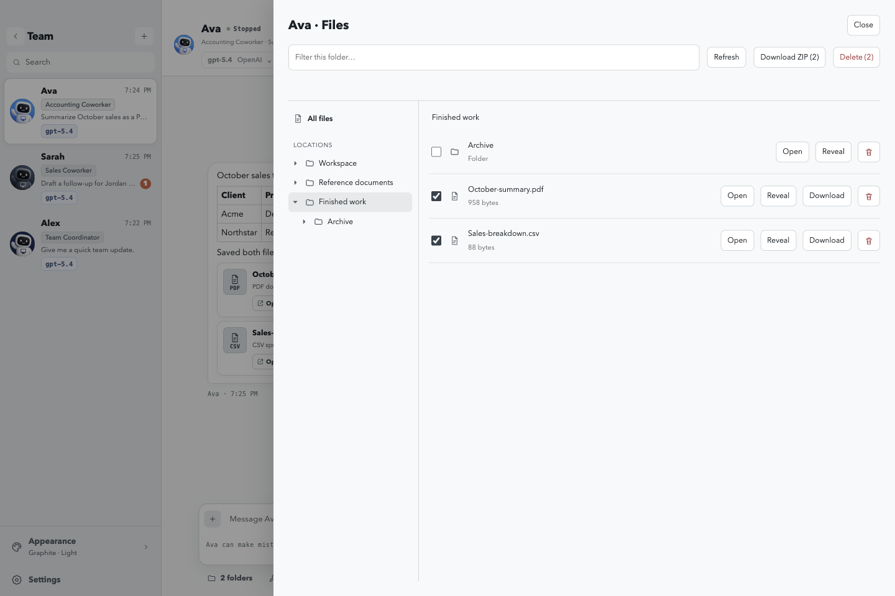
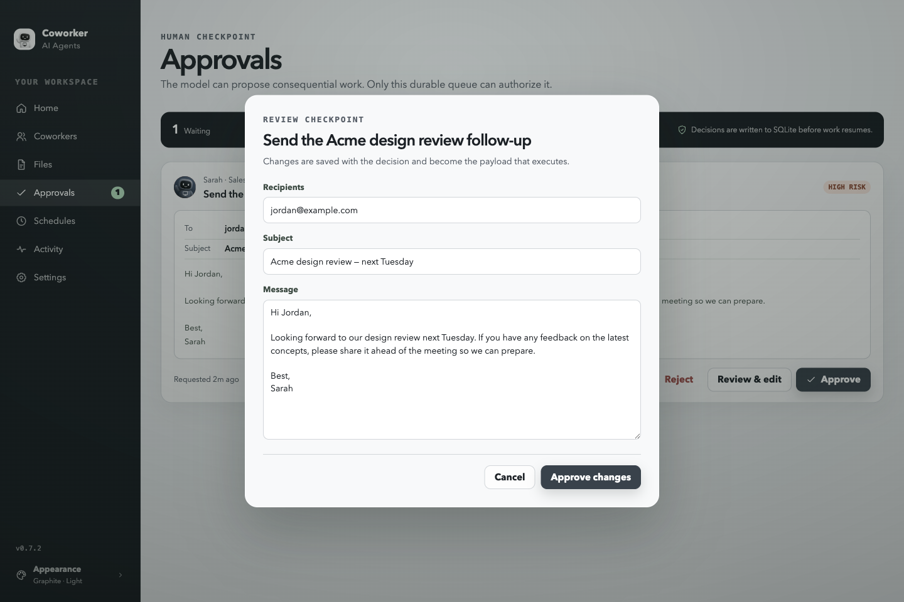

# Screenshots

Captured from Coworker **v0.7.2** in a fresh profile with fictional sample conversations and files. The [chat view](../README.md) is also the hero image on the main README.

**Home** — assign work to a coworker, follow team activity, review pending approvals, and open recent files. The right sidebar includes the time and date.

**Chat** — switch between coworkers in the left sidebar and open or download their created files from the conversation. The Files tab shows accessible folders, their permissions, and the default output folder; the folder list can be collapsed.

**File explorer** — open **Files** beside **History** and **New** in the coworker header. The explorer starts in the configured default output folder. Expand folders in the tree or choose **All files**, filter the list, and select files to download as a ZIP. Deleting files or folders requires confirmation.

**Approvals** — review the proposed action and its contents before approving, editing, or rejecting it. Decisions are saved before work resumes.

